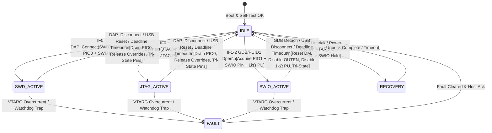

# Pico Universal — Production-Grade Product & Q1 Research Paper Master Design Specification

**Date:** 2026-11-19  
**Repository:** `nfsahsn/pico-universal-programmer`  
**Status:** Design Specification (Pending User Spec Review)  
**Target Product:** Commercial consumer-grade RP2040-based multi-architecture USB programmer, debugger, and UART bridge supporting **STM32 (F1/F4)**, **Raspberry Pi Pico (RP2040, expansion RP2350)**, **Espressif ESP32 (classic WROOM-32, expansion ESP32-S3)**, and **WCH CH32V003**.  
**Target Publication Venue:** **IEEE Transactions on Instrumentation and Measurement (TIM)** (primary) or **IEEE Access** (alternative Q1 fast-track), accompanied by an archival open-artifact replication package (Zenodo DOI + GitHub release).

---

## 1. Executive Summary & Recovered Baseline

### 1.1 Product & Research Vision
Embedded developers, educators, and hardware teams working across heterogeneous MCU ecosystems currently must purchase, wire, and configure four separate hardware probes (ST-Link, Raspberry Pi Debug Probe, ESP-Prog/FT2232H, and WCH-LinkE), each with incompatible USB drivers, IDEs, and failure modes. **Pico Universal** consolidates all four ecosystems into a single affordable consumer USB-C hardware probe powered by the Raspberry Pi **RP2040** microcontroller with an **officially approved Raspberry Pi USB PID (`VID 0x2E8A`)**, zero-reboot composite USB protocol arbitration, turnkey **Arduino IDE 2** upload/debug workflows (plus VS Code/OpenOCD/GDB), and production-grade electrical protection.

Simultaneously, the engineering artifacts, formal protocol state machines, fault-injection frameworks, electrical signal-integrity measurements, and multi-probe benchmarks are designed from day one to satisfy Q1 peer-review standards at **IEEE Transactions on Instrumentation and Measurement (TIM)** / **IEEE Access**.

### 1.2 Recovered Local Assets & Starting Baseline
Investigation of the repository and local workspace confirmed that the uncommitted November 2026 build worktrees (`mishanhasan-*`, `shakrabby-ideal-waffle`) were removed from disk, leaving four recoverable asset sources that form the authoritative starting baseline:

| Asset Source | Location | Reusable Value |
| :--- | :--- | :--- |
| **`origin/linux-focused` (`34daa75`)** | Git branch in this repo | Pinned upstream probe engine builds (`probes/debugprobe`, `probes/picorvd`), CRC32 image validation, two-bank power-cut-safe flash journal (4,353 fault-injection points), BOOTSEL 4 KiB sector-padded UF2 packager & ROM erase model, hardened CMSIS-DAP bounds/PIO/clock guards (`dap_guard.c`, `swj_sequence.c`, `pin_control.c`), hardened PicoRVD cross-page software breakpoints & packet parser, Linux `udev` rules, and UBSan host test suite. |
| **`pico-universal-setup`** | `~/.gemini/antigravity/scratch/pico-universal-setup` | Locked target matrix (`catalog/targets.json`) pinning STM32duino `2.12.0`, Arduino-Pico `6.1.1`, Arduino-ESP32 `3.3.11`, WCH CH32 `1.0.4`, board FQBNs, and SHA-256 locked Linux/Windows dependency archives. |
| **Phase 0 ESP32 OpenOCD config** | `~/pu phase0/pu-esp32.cfg` | Field-discovered classic ESP32 JTAG fixes: `ESP32_FLASH_VOLTAGE 3.3` MTDI strapping, Zbit `ZB25VQ32` QIO QE-bit reset-halt workaround on `gdb-attach`, startup halt timeout mitigation on `examine-end`, and post-debug `gdb-detach` auto-resume. |
| **Arduino & OpenOCD research dumps** | `~/research/`, `~/ch32v-src/`, `~/stm32research_2a7f9c_isolated/`, `~/arduino-ide-work/` | Reference board definitions, `cortex-debug` attributes, and OpenOCD transport/target scripts. |

### 1.3 Execution Strategy: Dual-Track Phased Qualification
The project executes across five tightly coupled sub-projects using a **Dual-Track Phased Qualification** model:
- **Track A (Firmware + Host Software on Off-the-Shelf Pico Dev Board):** Immediately rebase onto `origin/linux-focused`, build the unified composite USB firmware (with `PU_BOARD_PICO` profile), approved USB VID/PID descriptors, and Go `pu` CLI + Arduino IDE 2 / VS Code integration. Validate software + HIL on real target boards early.
- **Track B (Custom Production RP2040 PCB & Enclosure):** In parallel, design the 4-layer consumer production PCB (`PU_BOARD_PRO_PCB`), fabricate Rev A prototypes, run electrical/signal-integrity validation, iterate to Rev B DFM/EMC-hardened boards, and build the factory pogo-pin QC test jig.
- **Track C (Q1 Research Instrumentation & Manuscript):** Execute automated comparative benchmarks, oscilloscope signal-integrity sweeps, and fault-injection stress tests on Rev B production hardware against commercial reference probes, then author and submit the IEEE manuscript + Zenodo replication bundle.

---

## 2. Sub-Project 1: Consumer-Optimized Production Hardware (`PU_BOARD_PRO_PCB`)

### 2.1 Design Objectives & Consumer BOM Target
- **Target BOM Cost:** **$8–$12 USD** at 100–500 unit volume (undercutting ST-Link V3 Set ~$35 and J-Link Base ~$400 while covering 4 MCU ecosystems).
- **Zero-Compromise Consumer Reliability:** Survives common user mistakes (reversed/shorted target power, 5 V target I/O, ESD static discharge, hot-plugging, and bricked CH32V003 PD1 pins) without expensive industrial galvanic USB isolation (which adds $6–$10 BOM; deferred to an optional future "Pro Isolated" SKU).
- **Dual Board-Profile Compatibility:** GPIO assignments remain functionally identical between off-the-shelf Raspberry Pi Pico (`PU_BOARD_PICO`) and the custom PCB (`PU_BOARD_PRO_PCB`), with hardware-only extras (programmable VTARG load switch, switchable SWIO pull-up, ADC voltage/current telemetry) gated cleanly behind board-abstraction headers.

### 2.2 Electrical Architecture

```
                        +------------------------------------------------------------------+
                        |                  PICO UNIVERSAL PRO PCB (4-Layer)                |
                        |                                                                  |
[USB-C] --[5.1k CC]---->| [USBLC6-2SC6 ESD] -> [500mA Polyfuse] -> [3.3V LDO]              |
   |                    |         |                                     |                  |
   +--- DP/DM (90Ω) --->|      [RP2040 + W25Q32JV (4 MiB QSPI)] <-------+                  |
                        |       |       |        |        |      |                         |
                        |   PIO0/SWD  PIO1/SWIO UART0   ADC0/1  GPIO_CTRL                  |
                        |       |       |        |        |      |                         |
                        | [SN74AXC4T774 Directional  [Open-Drain [INA180 +                 |
                        |  Level Shifters 1.8V-5.0V]  SWIO FET +  VTREF Div]               |
                        |       |        (VREF Track)  1kΩ Sw PU]    |                     |
                        | [22-33Ω Series R]             |            |                     |
                        |       |                       |      [AP22811/TPS2553            |
                        | [Low-Cap TVS ESD Array] <-----+       3.3V VTARG Load Switch     |
                        |       |                               300-500mA Current Limit]   |
                        +-------|---------------------------------------|------------------+
                                v                                       v
                  [Keyed 10-Pin 2.54mm Universal Header]   [10-Pin 1.27mm ARM Cortex Header]
```

### 2.3 Key Circuit Subsystems
1. **Core Compute & Flash:**
   - **RP2040** clocked by 12 MHz ±20 ppm crystal (ABM8-272-T3 or equivalent) with hardware reference decoupling per Raspberry Pi's *Hardware Design with RP2040* guidelines.
   - **W25Q32JV (4 MiB QSPI NOR Flash):** Doubles storage over stock 2 MiB Pico to cleanly host the two-slot fail-safe OTA/UF2 bootloader, unified composite firmware, redundant two-bank config journal, and factory calibration/serial metadata.
2. **USB-C Front End:**
   - 16-pin USB-C receptacle with dual **5.1 kΩ CC1/CC2** pull-downs (proper USB-C host/C-to-C cable detection).
   - **USBLC6-2SC6** low-capacitance USB ESD suppressor (<1 pF) + **500 mA PPTC resettable polyfuse** + **AP2112K-3.3** (600 mA LDO) with bulk + ceramic decoupling.
   - 27 Ω series termination on USB DP/DM, routed as **90 Ω ±10% differential pair** over continuous Layer 2 GND reference plane.
3. **Wide-Voltage Directional Level Shifting (1.8 V–5.0 V):**
   - **Why directional shifters (`SN74AXC4T774` / `SN74LVC2T45`) over auto-direction `TXS0108E`:** Auto-direction shifters oscillate under capacitive ribbon cables and struggle above ~2–4 MHz SWD/JTAG. Directional shifters controlled directly by RP2040's PIO `OE`/direction pins deliver clean, monotonic edges up to **15–24 MHz SWD/JTAG** across 1.8 V, 3.3 V, and 5.0 V targets.
   - **VREF Tracking:** Target side (`VCCA`/`VCCB`) powered from target `VTREF` (or internal switchable 3.3 V when supplying target power), with `I_off` partial-power-down support so the probe never back-powers an unpowered target board.
   - **Signal Conditioning & Protection:** 22–33 Ω series damping resistors + ultra-low-capacitance TVS diodes (`TPD4E05U06` / `PESD5V0U1BA`, <1 pF) on every target-facing line (`SWCLK/TCK`, `SWDIO/TMS`, `TDI`, `TDO`, `NRST`, `SWIO`, `UART_TX`, `UART_RX`).
4. **CH32V003 1-Wire SWIO & Unbrick Front End:**
   - Dedicated open-drain bidirectional stage with **software-switchable 1 kΩ pull-up to VTREF** (eliminates the manual external pull-up resistor required on breadboards, and disconnects cleanly when SWIO is idle).
   - **Programmable Target Power Switch (`AP22811` / `TPS2553`, 300–500 mA current-limited + fault flag):** Allows the firmware to execute a deterministic **power-cycle + immediate SWIO hold-before-user-code unbrick sequence** when a CH32V003 sketch repurposes `PD1` or enables read-out protection.
5. **Built-In Telemetry (Dual Consumer + Research Value):**
   - **RP2040 ADC0:** `VTREF` voltage monitor (precision 1% resistor divider, 0–5.5 V range, ~1.5 mV resolution) — catches unpowered targets, brownouts, and 5 V/3.3 V mismatches before driving signals.
   - **RP2040 ADC1:** Low-cost high-side current monitor (`INA180A1` + 100 mΩ 1% shunt on VTARG rail, 0–500 mA range) — reports real-time target current, short-circuit trips, and supports power-budget measurements in the Q1 paper.
6. **Connectors, Indicators & Mechanical Enclosure:**
   - **Primary Consumer Header:** Keyed 10-pin 2.54 mm shrouded box header with color-coded breakout ribbon cable (`VTREF`, `VTARG_OUT`, `GND`, `SWCLK/TCK`, `SWDIO/TMS`, `TDI`, `TDO`, `NRST`, `SWIO`, `UART_TX/RX` — or dual keyed 2×5 + 1×4 UART/SWIO layout with zero pin ambiguity).
   - **Standard ARM Header:** 10-pin 1.27 mm Cortex-M debug header (populated directly on PCB for professional STM32/Pico boards).
   - **User Interface:** 1 diffused **RGB LED** (hardware-driven state/error indicator) + recessed tactile **Recovery/BOOTSEL button** (normal operation requires zero button presses).
   - **PCB Stackup & Enclosure:** 4-layer FR-4 (`Signal / Solid GND / Power+GND / Signal`, JLC04161H-7628 impedance profile), compact thumb-drive form factor (~55 mm × 24 mm × 12 mm), snap-fit ABS/ASA enclosure (3D-printed for Rev A/B pilots, injection-mold-ready draft angles for mass production) with laser-etched pinout table on the bottom face.

### 2.4 Canonical GPIO Pin Mapping (`PU_BOARD_PICO` vs. `PU_BOARD_PRO_PCB`)

A single compile-time board header (`config/board_pinout.h`) selects between off-the-shelf Raspberry Pi Pico compatibility (preserving existing breadboard wiring) and the custom production PCB:

| Function | `PU_BOARD_PICO` (Dev) | `PU_BOARD_PRO_PCB` (Prod) | Peripheral / Bus | Pro PCB Hardware Stage |
| :--- | :--- | :--- | :--- | :--- |
| Target UART TX / RX | `GP0` / `GP1` | `GP0` / `GP1` | UART0 (DMA) | Directional level shifter + ESD |
| SWCLK / TCK, SWDIO / TMS | `GP2` / `GP3` | `GP2` / `GP3` | PIO0 | Directional shifter + `GP6` `SWDIO_DIR` + 22–33 Ω + ESD |
| JTAG TDI / TDO | `GP4` / `GP5` | `GP4` / `GP5` | PIO0 | Directional shifter + 22–33 Ω + ESD |
| Target `NRST` (Open-Drain) | `GP6` | `GP7` | GPIO / PIO | Active-low open-drain MOSFET + ESD |
| CH32V003 1-Wire `SWIO` | `GP28` *(ext. 1 kΩ PU)* | `GP8` | PIO1 | Open-drain bidirectional + `GP9` switchable 1 kΩ PU |
| `VTARG_EN` / `VTARG_FAULT_N` | N/A | `GP10` / `GP11` | GPIO | `AP22811`/`TPS2553` load switch & overcurrent IRQ |
| Status LED(s) | `GP25` (+ opt. `GP16–18`) | `GP12` / `GP13` / `GP14` | PWM | Diffused RGB status LED |
| Recovery / Factory Button | `GP15` (Active-LOW, PU) | `GP15` (Active-LOW, PU) | GPIO | Recessed tactile recovery switch |
| `VTREF` / `I_TARG` Telemetry | N/A | `GP26` (`ADC0`) / `GP27` (`ADC1`) | 12-bit ADC | 1% divider (0–5.5 V) + `INA180A1` & 100 mΩ shunt |

---

## 3. Sub-Project 2: Unified RP2040 Composite Firmware & Approved USB PID

### 3.1 Approved Raspberry Pi USB VID/PID & OS Plug-and-Play
- **USB Identity:** `VID = 0x2E8A` (Raspberry Pi), `PID = PU_USB_PID` (injected at CMake configure time from your approved Raspberry Pi PID allocation, keeping exact hex configurable per SKU/revision).
- **Unique Hardware Serial Number:** Derived deterministically from the external QSPI Flash 64-bit Unique ID (`flash_get_unique_id`), formatted as a 16-character uppercase hex string so multiple Pico Universal probes plugged into the same PC never collide.
- **Zero-Driver OS Integration:**
  - **Windows 10/11:** Embed **Microsoft OS 2.0 (WCID)** descriptors binding IF 0 (CMSIS-DAP v2) and IF 5 (Vendor Control) directly to `WINUSB.SYS`, and standard USB CDC-ACM drivers (`usbser.sys`) for IF 1–2 (SWIO GDB) and IF 3–4 (Target UART). Zero `.inf` files or Zadig required.
  - **Linux:** Ship deterministic `udev` rules (`60-pico-universal.rules`) matching `ATTRS{idVendor}=="2e8a", ATTRS{idProduct}=="<PID>"` with `TAG+="uaccess"`, plus `ID_MM_DEVICE_IGNORE="1"` so `ModemManager` never corrupts the GDB or UART CDC ports during enumeration.

### 3.2 USB Composite Interface Layout (TinyUSB)

RP2040 exposes 16 hardware endpoints; the composite configuration uses 6 USB interfaces (IF 0–5) across EP0–EP6:

| Interface(s) | USB Class | Endpoints | Protocol / Role |
| :--- | :--- | :--- | :--- |
| **IF 0** | Vendor-Specific (WinUSB Bulk) | EP1 OUT/IN (64 B Bulk) | **CMSIS-DAP v2** — ARM SWD (STM32, RP2040/RP2350) & 4-wire JTAG (ESP32/ESP32-S3). Compatible with OpenOCD `cmsis-dap`, pyOCD, and probe-rs. |
| **IF 1–2** (IAD) | CDC-ACM (Comm + Data) | EP2 IN (INT), EP3 OUT/IN | **CH32V003 SWIO GDB RSP + `PUID1` Check Engine** — Hardened PicoRVD-derived GDB remote stub + deterministic `PUID1` identity/unbrick commands. |
| **IF 3–4** (IAD) | CDC-ACM (Comm + Data) | EP4 IN (INT), EP5 OUT/IN | **Target UART Bridge** — Concurrent non-blocking DMA UART bridge (up to 3 Mbaud) with live baud/parity/stop-bit sync from USB `SET_LINE_CODING`. |
| **IF 5** | Vendor-Specific (WinUSB Bulk + Control) | EP6 OUT/IN + EP0 Vendor | **Probe Control, Telemetry & Diagnostics** — Version/capabilities query, active engine owner status, live VTREF/current readings, `VTARG` power-cycle, self-test, and safe firmware update trigger. |

### 3.3 Core Architectural Novelty: Deterministic PIO & Pin Engine Arbitrator (`engine_owner`)
To eliminate manual mode-switching reboots while guaranteeing electrical and timing safety across heterogeneous debug protocols, all debug physical layers are governed by a formal, verified **Engine Owner Finite-State Machine (`engine_owner`)**:



**Guaranteed Invariants (verified both in C unit tests and formally analyzed in the Q1 paper):**
1. **Strict Mutual Exclusion:** Only one debug transport (`SWD`, `JTAG`, `SWIO`, or `RECOVERY`) may own the target debug pins at any instant. Concurrent acquisition attempts from another USB interface return an explicit, non-blocking busy status (`DAP_ERROR` / `PUID1:ERR_ENGINE_BUSY`) without corrupting an active session. Target UART (IF 3–4) operates independently on dedicated UART0 + DMA channels so serial output remains uninterrupted during flashing and debugging.
2. **Zero Pin-Ownership Leakage:** Transitioning to `IDLE` executes an atomic teardown: drain PIO TX/RX FIFOs, halt state machines, clear SIO GPIO overrides, disable SWIO pull-up FET, and place all debug pins into high-impedance (`Hi-Z`) inputs.
3. **Bounded Wire Deadlines:** Every SWD transfer, JTAG scan, and SWIO read/write carries a strict hardware-timer deadline (derived from `time_us_64()`), eliminating infinite loops when a target disconnects mid-transfer.
4. **Core Partitioning on Dual-Core RP2040:**
   - **Core 0:** TinyUSB stack, USB framing/packet snapshotting (`dap_guard`), CDC UART DMA ring management, `engine_owner` arbitration, ADC telemetry sampling, RGB LED & watchdog supervision.
   - **Core 1:** Deterministic real-time protocol execution (PIO0 SWD/JTAG command dispatch, PIO1 CH32V003 SWIO bit-level framing & flash-page programming) fed via lock-free SPSC queues (`swio_fifo` / `dap_queue`). Zero USB IRQ jitter on wire timing!

### 3.4 Hardened Protocol Subsystems (Carrying Forward Every Proven Fix)
- **CMSIS-DAP v2 Engine (`probes/debugprobe` + `dap_guard`):**
  - Pre-execution length, command-count, JTAG chain-size, and max-response-size validation (fuzzed with 50,000+ deterministic malformed packets).
  - Private request-packet snapshotting before execution so USB resets cannot mutate in-flight batches.
  - 64-bit clock-divider math with 1 kHz floor and mandatory clock-cache invalidation on SWD entry.
  - Explicit PIO-to-SIO pin-override handoff for `DAP_SWJ_Pins` (reset pulsing / direct pin control).
- **CH32V003 SWIO Engine (`probes/picorvd` + `ch32_identity`):**
  - **Wire-Accurate Silent-Bus Disambiguation:** Explicitly distinguishes floating-high pull-up (`0xFFFFFFFF`) and shorted-low (`0x00000000`) silent reads from a genuinely halted chip via strict QingKe V2 `DMSTATUS` bitfield validation (including reserved-zero bits), reporting actionable 5-cause diagnostics (power, ground, pull-up, PD1 reuse, read protection).
  - **Non-Destructive `PUID1` Pre-Flight Identity Check:** Reads chip ID / flash size without writing flash, refuses already-halted targets unless forced, restores touched registers, verifies post-resume running state, and confirms `WCH_DM_SHDWCFGR.OUTEN == 0` readback before latching `CFGR`.
  - **Safe Cross-Page Software Breakpoints:** Tracks both flash pages for 4-byte instructions crossing 64-byte boundaries, validates bounds/overlap, propagates failures, rejects unsupported hardware breakpoint packets cleanly per GDB RSP spec, and restores all patched flash pages on disconnect.
- **Fail-Safe A/B Bootloader & Persistent Journal:**
  - Retains the proven **two-bank CRC32 flash configuration journal** (tested across 4,353 simulated power-cut interruption points) and **4 KiB sector-padded BOOTSEL UF2 packager** (validated against the RP2040 boot ROM erase bitmap model) from `origin/linux-focused`.
  - Uses a shared 2 MiB base partition map (`config/flash_layout.json`) compatible with both stock 2 MiB Pico and 4 MiB Pro PCB (which reserves the upper 2 MiB for future expansion & extended factory calibration):

  | Partition | Flash Offset | Size | Purpose |
  | :--- | :--- | :--- | :--- |
  | `bootloader` | `0x000000` | 60 KiB | Immutable CRC32 A/B chainloader & recovery button handler |
  | `journal_a` | `0x00F000` | 4 KiB | Primary power-cut-safe config & active-slot journal |
  | `app_slot_a` | `0x010000` | 960 KiB | Active Unified Composite Firmware (Slot A) |
  | `app_slot_b` | `0x100000` | 960 KiB | Staging / Rollback Unified Composite Firmware (Slot B) |
  | `journal_b` | `0x1F0000` | 4 KiB | Redundant backup config journal |
  | `factory_meta` | `0x1FF000` | 4 KiB | Read-only factory QC calibration, board revision & PCB SKU |

---

## 4. Sub-Project 3: Cross-Platform Host CLI (`pu`) & Turnkey IDE Integration

### 4.1 Single Static Host Binary (`pu`, Written in Go)
Consumers must never manually install Python, Zadig, OpenOCD builds, or hand-edit Arduino config files. A single static, zero-dependency Go binary (`pu` on Linux x86-64/ARM64, `pu.exe` on Windows x86-64) orchestrates the entire lifecycle:

| Subcommand | Consumer & Engineering Responsibility |
| :--- | :--- |
| **`pu setup`** | One-command installer merging `pico-universal-setup`: installs/verifies Arduino IDE 2 cores (`STM32duino`, `Arduino-Pico`, `Arduino-ESP32`, `WCH CH32`) and pinned OpenOCD / RISC-V GDB toolchains from SHA-256-verified lockfiles (`catalog/targets.json`), installs Linux `udev` rules or verifies Windows WinUSB binding, registers `platform.local.txt` / `programmers.local.txt` / `debug_custom.json`, and supports `--offline`, `--verify`, and clean `--uninstall`. |
| **`pu check`** | Pre-flight non-destructive board & probe health check: discovers probe by `VID:PID` + USB topology (`linux_tree` / `windows_tree`), reads probe `VTREF` & `I_TARG` telemetry, probes target IDCODE/ROM-table or CH32 `PUID1`, detects genuine vs clone STM32 MCUs (e.g. CS32/CKS32/GD32) and locked flash, and emits clear remediation messages. |
| **`pu upload`** | Atomic firmware uploader invoked by Arduino IDE 2 or CLI: snapshots input ELF/BIN artifacts to a private temporary directory (eliminating mid-rebuild races), validates segment erase boundaries (rejecting overlapping ESP32 4 KiB sectors), locks the target probe serial across processes, flashes, performs mandatory readback verification, and resets target to run. |
| **`pu gdb-pipe`** | Reliable cross-platform GDB stdio/TCP relay connecting Arduino IDE 2 (`cortex-debug`) or VS Code GDB directly to the probe's CH32V003 SWIO CDC port (or OpenOCD CMSIS-DAP server for ARM/ESP32) with USB serial-number binding, lockfile arbitration, and clean disconnect/cleanup handling. |
| **`pu recover`** | Guided consumer recovery tool: executes CH32V003 power-cycle unbrick (for PD1-reused or read-protected chips), STM32 connect-under-reset mass erase, or probe firmware DFU/UF2 update. |
| **`pu bench`** | Automated instrumentation & benchmarking runner (directly drives the Q1 paper evaluation matrix, outputting CSV/JSON datasets with timestamps, throughput, latency percentiles, and fault-injection results). |

### 4.2 Turnkey Arduino IDE 2 & VS Code Integration
- **Arduino IDE 2 (Primary Consumer Flow):**
  1. Consumer runs one setup script (`./setup.sh` on Linux or `setup.ps1` / `pu-setup.exe` on Windows).
  2. Connects Pico Universal via USB-C and attaches target board using the keyed ribbon cable.
  3. Selects board in **Tools → Board** and `Pico Universal` in **Tools → Programmer**.
  4. Clicks **Upload Using Programmer** (`Ctrl+Shift+U`) or **Start Debugging** (one-click hardware breakpoints, stepping, variables, registers) with **zero manual mode switching**, while **Serial Monitor** streams target UART concurrently.
- **Embedded Target Workarounds (Automated Behind the Scenes):**
  - **Classic ESP32 (`pu-esp32.cfg`):** Automatically injects `adapter serial <SN>`, `ESP32_FLASH_VOLTAGE 3.3`, Zbit `ZB25VQ32` QIO QE-bit `gdb-attach` reset-halt protection, `examine-end` startup-halt timeout fix, and `gdb-detach` auto-resume.
  - **STM32 F1/F4:** Supports connect-under-reset (`reset_config srst_only srst_nogate connect_assert_srst`) for sleep/SWD-disabled sketches and explicit clone-ID diagnostics.
  - **RP2040 / RP2350:** Dual-core SWD multidrop (`target/rp2040.cfg`) with safe flash reset-halt.
  - **CH32V003:** Automated `pu gdb-pipe` bridge + `set breakpoint auto-hw off` initialization so Arduino IDE 2 / GDB software breakpoints work out of the box.
- **VS Code / PlatformIO / Native CLI (Secondary Power-User Flow):**
  - `pu export-vscode` generates ready-to-run `.vscode/launch.json` and OpenOCD `.cfg` files for `cortex-debug` and `riscv-none-elf-gdb`.

### 4.3 Qualified Target Matrix (v1 Production)

| Family | v1 Qualified Boards (Initial Release) | Expansion (v1.1 / Paper Outlook) | Debug Transport |
| :--- | :--- | :--- | :--- |
| **STM32** | Blue Pill (`F103C8`/`CB` + clone detection), Black Pill (`F401CC`/`F411CE`), DevEBox (`F407VE`/`VG`), Nucleo-64 (`F401RE`/`F411RE`/`F446RE`) | STM32G0 / H7 | CMSIS-DAP v2 SWD |
| **Raspberry Pi** | Pico (`RP2040`), Pico W (`RP2040`) | Pico 2 / Pico 2 W (`RP2350`) | CMSIS-DAP v2 SWD (Multidrop) |
| **Espressif** | Classic ESP32 DevKit / NodeMCU-32S (`ESP32-WROOM-32`, incl. Zbit QIO flash) | `ESP32-S3-DevKitC-1` | CMSIS-DAP v2 4-Wire JTAG |
| **WCH RISC-V** | `CH32V003F4P6` Dev Board (incl. PD1-reused & read-protected unbrick) | `CH32V203` / `CH32X035` | PIO1 1-Wire SWIO + GDB |

---

## 5. Sub-Project 4: Verification, Hardware Qualification, Compliance & Manufacturing

### 5.1 Four-Layer Automated Verification Pipeline
1. **Layer 1 — Deterministic Host C/C++ & Go Verification (CI on Every Commit):**
   - Compile actual firmware C/C++ modules (`engine_owner`, `dap_guard`, `ch32_identity`, `SoftBreak`, `storage` journal, `image_validator`, `usb_descriptors`) on Linux/Windows hosts with **AddressSanitizer (ASan) + UndefinedBehaviorSanitizer (UBSan)**.
   - Run **50,000+ deterministic fuzzed CMSIS-DAP & GDB packets**, silent-bus wire models (`0xFFFFFFFF` & `0x00000000`), **4,353+ flash-journal power-cut injection points**, and **RP2040 BOOTSEL ROM UF2 sector-erase simulations**.
   - Run full Go unit & mock USB-tree test suite (`go test -race ./...`) for Linux and Windows targets.
2. **Layer 2 — Reproducible Build & Provenance Gate:**
   - Pinned Pico SDK, TinyUSB, upstream probe submodules, Go toolchain, and ARM GCC toolchain hashes.
   - Clean double-build bit-for-bit reproducibility check (`sha256sum` match across two independent build directories).
   - Automated **SPDX SBOM & Third-Party License Audit** verifying commercial compatibility (BSD/MIT/Apache/GPLv2/v3 obligations — critically ensuring any GPL-licensed upstream components like OpenOCD or PicoRVD derivatives are cleanly separated or compliant with source-offer obligations!).
3. **Layer 3 — Physical Hardware-in-the-Loop (HIL) Qualification Matrix:**
   - Automated test bench exercising **every v1 board** across Linux and Windows 10/11:
     - Cold boot, USB enumeration (WinUSB + udev), zero-driver verification.
     - 100× continuous Flash + SHA-256 Readback Verify cycles per target family.
     - Automated GDB session: attach, halt, register read/write, memory read/write, software/hardware breakpoint hit, single-step, detach, confirm target resumes running.
     - Rapid zero-reboot cross-family switching: STM32 SWD → ESP32 JTAG → CH32V003 SWIO → RP2040 SWD → concurrent UART stress.
     - Physical fault injection: unplug target mid-flash, short `VTARG` to GND (verify load-switch current-limit trip & recovery), hold recovery button during boot, CH32V003 `PD1`-reused sketch unbrick.
4. **Layer 4 — Production Manufacturing, Compliance & QC Test Jig:**
   - **DFM/DFT:** Standard JLCPCB/PCBWay 4-layer rules, SMT single-sided placement where possible to minimize PCBA assembly cost, exposed bottom test pads for all GPIOs, USB, VREF, and VTARG.
   - **Bed-of-Nails Factory Test Fixture:** Pogo-pin jig powered by a master test PC running `pu factory-qc`:
     1. Checks 3.3 V rail & quiescent current (catches shorts before USB bring-up).
     2. Flashes factory A/B unified `.uf2` via BOOTSEL.
     3. Verifies USB enumeration (`0x2E8A:<PID>`), unique flash serial number, RGB LED check, button check.
     4. Executes loopback continuity test across all level-shifted target lines at **1.8 V, 3.3 V, and 5.0 V**, checks ADC `VTREF`/`I_TARG` accuracy within ±3%, and verifies `VTARG` current-limit trip.
     5. Logs serial number + calibration + pass/fail certificate to JSON/CSV manufacturing database.
   - **Regulatory Compliance Path:**
     - **RoHS / REACH:** Lead-free HASL/ENIG + RoHS-compliant BOM components only.
     - **FCC Part 15 Subpart B (Class B) & CE (EN 55032 / EN 55035):** Controlled 90 Ω USB routing, unbroken GND plane, series damping resistors on fast PIO clock lines, ESD protection on USB + target port, followed by accredited lab EMC/ESD pre-compliance scan before retail launch.

---

## 6. Sub-Project 5: Q1 Research Paper Plan (IEEE TIM / IEEE Access)

### 6.1 Why This Can Pass Q1 Peer Review (Avoiding the "Hobbyist Tool" Rejection)
Q1 reviewers at **IEEE Transactions on Instrumentation and Measurement (TIM)** and **IEEE Access** immediately reject "we built a cheap programmer" papers unless they deliver **generalizable systems/instrumentation contributions, formal analysis, and rigorous quantitative measurements**. Our product engineering is explicitly structured to produce **four high-bar scientific contributions**:

1. **Contribution 1 — Deterministic Dual-Core PIO-Arbitrated Multi-Protocol Architecture:**
   - Mathematical timing model and formal finite-state machine (`engine_owner`) proving deterministic, zero-contention multiplexing of heterogeneous physical debug layers (synchronous bidirectional ARM SWD, synchronous 4-wire JTAG, asynchronous 1-wire proprietary WCH SWIO, and full-duplex DMA UART) onto a single sub-$1 dual-core Cortex-M0+ MCU with Programmable I/O (PIO) coprocessors.
   - Quantifies Core 0/Core 1 CPU utilization, PIO instruction-memory occupancy (out of 32 instructions per PIO block), and USB-to-wire jitter reduction vs bit-banged or single-core implementations.
2. **Contribution 2 — Wire-Accurate Fault-Tolerant Protocol & Storage Engineering:**
   - Formal fault model and empirical evaluation of four real-world embedded-probe failure classes rarely analyzed in literature:
     1. *RP2040 BOOTSEL sparse-UF2 sector-erase corruption* (modeled & prevented via 4 KiB sector padding),
     2. *Power-loss configuration corruption* (proven across 4,353 atomic fault-injection points in a dual-bank CRC32 journal),
     3. *Floating/shorted 1-wire silent-bus aliasing* (`0xFFFFFFFF`/`0x00000000` disambiguation in WCH SWIO), and
     4. *Malformed USB packet boundary exploits* (50,000-vector deterministic fuzzing + packet snapshotting).
   - Introduces the non-destructive multi-ISA target & counterfeit/clone MCU fingerprinting pipeline (`PUID1` + SWD/JTAG ROM-table verification).
3. **Contribution 3 — Wide-Voltage (1.8 V–5.0 V) Electrical Front-End & Signal Integrity Characterization:**
   - Oscilloscope characterization comparing directional level shifting (`SN74AXC4T774`) + series termination against unbuffered Pico GPIOs and auto-direction shifters across 1.8 V / 3.3 V / 5.0 V and cable lengths (10 cm, 25 cm, 50 cm): rise/fall time ($t_r, t_f$), overshoot/undershoot (% $V_{DD}$), clock-to-data setup/hold margin, cycle-to-cycle jitter, and maximum error-free SWD/JTAG/SWIO frequency.
   - Overcurrent/short-circuit protection step-response oscilloscope captures (`VTARG` trip time & voltage droop).
4. **Contribution 4 — Head-to-Head Multi-Ecosystem Empirical Benchmark vs. Commercial Probes:**
   - Controlled, statistically rigorous benchmark across **4 heterogeneous MCU architectures** (ARM Cortex-M3/M4 STM32, ARM Cortex-M0+ RP2040, Xtensa LX6 ESP32, RISC-V QingKe V2 CH32V003) comparing **Pico Universal** against five commercial/vendor reference instruments:
     - **SEGGER J-Link** (EDU / Base)
     - **STMicroelectronics ST-Link V2 & ST-Link V3**
     - **Official Raspberry Pi Debug Probe**
     - **WCH-LinkE**
     - **Espressif ESP-Prog (FT2232H)**

### 6.2 Quantitative Experimental Evaluation Matrix (Using Your Lab Equipment)

| Exp. ID | Measurement Domain | Instruments Used | Metrics & Statistical Rigor |
| :--- | :--- | :--- | :--- |
| **E1** | **Flash Programming & Verify Throughput** | `pu bench` + OpenOCD/GDB + Target Matrix | Effective write + verify throughput (KiB/s) across payload sizes (4 KiB, 16 KiB, 64 KiB, 256 KiB, 1 MiB); $N=30$ trials per point; report mean, SD, 95% CI, and speedup/ratio vs each reference probe. |
| **E2** | **Interactive Debug Latency** | `pu bench` + Logic Analyzer | End-to-end latency (ms) for `halt`, `read-all-regs`, `single-step`, `insert/hit/remove breakpoint`, and `detach-resume`; $N=100$ trials; report median, p95, p99, and boxplots. |
| **E3** | **Protocol Switching & Concurrent UART Impact** | Logic Analyzer + `pu bench` | Zero-reboot switch latency (SWD ↔ JTAG ↔ SWIO) vs multi-boot reboot vs manual probe swap; measure throughput degradation (if any) under concurrent 115.2 kbps and 2 Mbps UART traffic. |
| **E4** | **Signal Integrity & Timing Margins** | Oscilloscope (100+ MHz) + Logic Analyzer | Waveform captures of SWCLK/SWDIO/SWIO at 1.8 V, 3.3 V, 5.0 V across 10/25/50 cm cables: $t_r, t_f$, overshoot, eye/setup-hold margin, max stable clock frequency ($f_{\max}$), and `VTARG` short-circuit trip time ($\mu\text{s}$). |
| **E5** | **Fault Injection & Reliability Stress** | Host ASan/UBSan + HIL Relay/Bench | (a) 50,000 malformed USB packets, (b) 4,353 flash-journal power-cut states, (c) 1,000 automated HIL flash+debug cycles across all 4 families, (d) 50 injected mid-flash USB/target disconnects & CH32V003 PD1-unbrick recoveries — report recovery rate (%). |
| **E6** | **Cost-Efficiency & Ecosystem Consolidation** | Verified BOM + Commercial Retail Quotes | Normalized total BOM & retail cost per supported ISA/protocol, bench footprint, setup time (minutes to first blink+breakpoint for novice users), and $/(\text{KiB}\cdot\text{s}^{-1})$. |

### 6.3 Proposed IEEE TIM / IEEE Access Manuscript Outline (10–12 Pages, IEEEtran Two-Column)
- **Title Candidate:** *"A Deterministic PIO-Arbitrated Multi-Protocol USB Debug and Programming Instrument for Heterogeneous Microcontrollers"*
- **Section I. Introduction:** Fragmentation of modern embedded debugging across ARM/Xtensa/RISC-V; gap between low-cost single-vendor probes and expensive commercial tools; summary of 4 quantitative contributions.
- **Section II. Related Work & Comparative Taxonomy:** Structured comparison table of commercial probes (J-Link, ST-Link V3, ESP-Prog, WCH-LinkE, Black Magic Probe, Raspberry Pi Debug Probe, DAPLink) across ISAs, physical layers, voltage range, fault resilience, open-source status, and cost.
- **Section III. System & Hardware Architecture:** Custom 4-layer RP2040 instrumentation PCB, directional wide-voltage front end, switchable SWIO open-drain stage, load-switch protection & ADC telemetry, signal-integrity design rules.
- **Section IV. Unified Composite Firmware & Formal PIO Arbitration:** Composite USB descriptor model (`VID 0x2E8A`), Core 0/Core 1 partitioning, formal `engine_owner` FSM & mutual-exclusion proof, PIO cycle-accurate timing models for SWD/JTAG/SWIO, and fault-tolerant storage/protocol hardening.
- **Section V. Cross-Platform Host Architecture & Non-Destructive Identification:** `pu` orchestration engine, USB device-tree binding, `PUID1` multi-ISA fingerprinting, and IDE integration architecture.
- **Section VI. Experimental Setup & Results (E1–E6):** Detailed hardware testbed, oscilloscope/logic-analyzer figures, statistical throughput & latency comparisons, fault-injection verification tables, and cost-efficiency analysis.
- **Section VII. Threats to Validity, Limitations & Commercial Deployment:** Honest engineering discussion (e.g., lack of galvanic isolation in base consumer SKU, USB Full-Speed 12 Mbps ceiling vs USB High-Speed 480 Mbps on J-Link/ST-Link V3, CH32 SWIO family specificity, EMC pre-compliance status).
- **Section VIII. Conclusion & Open Replication Artifacts:** Summary + permanent Zenodo DOI link to firmware, KiCad schematics/Gerbers, `pu bench` scripts, and raw CSV/waveform datasets.

---

## 7. Integrated Roadmap & Milestones

| Phase | Track | Key Deliverables | Exit Gate |
| :--- | :--- | :--- | :--- |
| **Phase 0** | Foundation | Rebase/unify `origin/linux-focused` + `pico-universal-setup` + `pu-esp32.cfg` into clean monorepo structure; configure approved `PU_USB_PID` & CI (ASan/UBSan + Go race). | Clean CI build on Linux & Windows runners. |
| **Phase 1** | Track A (Firmware) | Unified RP2040 composite USB firmware (`IF0` CMSIS-DAP v2, `IF1–2` CH32 SWIO GDB/`PUID1`, `IF3–4` UART DMA, `IF5` Control/Telemetry) + `engine_owner` FSM + A/B CRC32 bootloader & sector-padded UF2. | All host C/C++ fuzz, journal, wire-model, and UF2 ROM tests pass under ASan/UBSan; boots & enumerates on Pico with zero drivers on Win/Linux. |
| **Phase 2** | Track A (Host/IDE) | Go `pu` CLI (`setup`, `check`, `upload`, `gdb-pipe`, `recover`, `bench`) + turnkey Arduino IDE 2 & VS Code integration across Linux & Windows. | Real HIL pass on all 4 v1 target families (STM32 F1/F4, RP2040, classic ESP32, CH32V003) using Pico dev board. |
| **Phase 3** | Track B (Hardware) | KiCad 4-layer schematic & PCB layout (`PU_BOARD_PRO_PCB` Rev A), BOM/DFM review, enclosure CAD, fabricate & bring up 5–10 Rev A units, measure SI/protection, iterate to Rev B + factory pogo-pin QC jig. | Rev B passes 1.8 V–5.0 V signal integrity, overcurrent trip, 100-cycle HIL matrix, and automated factory QC. |
| **Phase 4** | Track C (Q1 Paper) | Run full E1–E6 benchmark suite on Rev B vs commercial probes (J-Link, ST-Link, Debug Probe, WCH-LinkE, ESP-Prog), generate publication figures & statistical tables, archive Zenodo replication package, draft & submit IEEE TIM / IEEE Access manuscript. | Reproducible datasets + complete IEEEtran manuscript ready for submission. |
| **Phase 5** | Production Launch | Third-party license compliance package, EMC/ESD lab scan (FCC/CE), pilot batch manufacturing (50–100 units) with factory QC logs, consumer quick-start guide & public release. | Signed-off production release candidate ready for customer shipment. |

---

## 8. Key Risks & Mitigations

| Risk | Severity | Concrete Mitigation |
| :--- | :--- | :--- |
| **USB Full-Speed (12 Mbps) throughput ceiling vs High-Speed probes** | Medium | Use CMSIS-DAP v2 Bulk endpoints (not HID), double-buffered TinyUSB bulk transfers, Core 1 PIO pipelining, and frame this honestly in Section VII as a deliberate sub-$10 consumer cost/performance Pareto frontier (comparing $/KiB·s⁻¹). |
| **Open-source licensing conflicts for commercial hardware** | High | Audit every bundled firmware/host component in Phase 0/4: keep GPL components (OpenOCD, GDB, any GPLv3 PicoRVD source) either cleanly external/hosted with exact source-offer tarballs or re-implement clean BSD/MIT SWIO/DAP code where proprietary firmware distribution is desired. |
| **CH32V003 silent-bus / PD1 bricking in consumer hands** | High | Hardware-controlled `VTARG` power-cycle MOSFET + software-switchable 1 kΩ pull-up + wire-accurate `0xFF`/`0x00` detection + one-click `pu recover` command. |
| **PIO instruction-space pressure (32 instructions per PIO block)** | Medium | Partition SWD/JTAG onto PIO0 (swapping tiny 12–16 instruction programs only on `IDLE -> SWD/JTAG` transition) and SWIO onto PIO1, keeping instruction budgets well below 32 words with zero runtime stalls. |
| **Q1 reviewer skepticism ("engineering project, not research")** | High | Lead with formal `engine_owner` arbitration invariants, quantitative fault-injection statistics (4,353 + 50,000 + 1,000 cycles), oscilloscope 1.8–5.0 V signal-integrity sweeps, and statistically rigorous multi-probe comparative benchmarks (E1–E6). |
